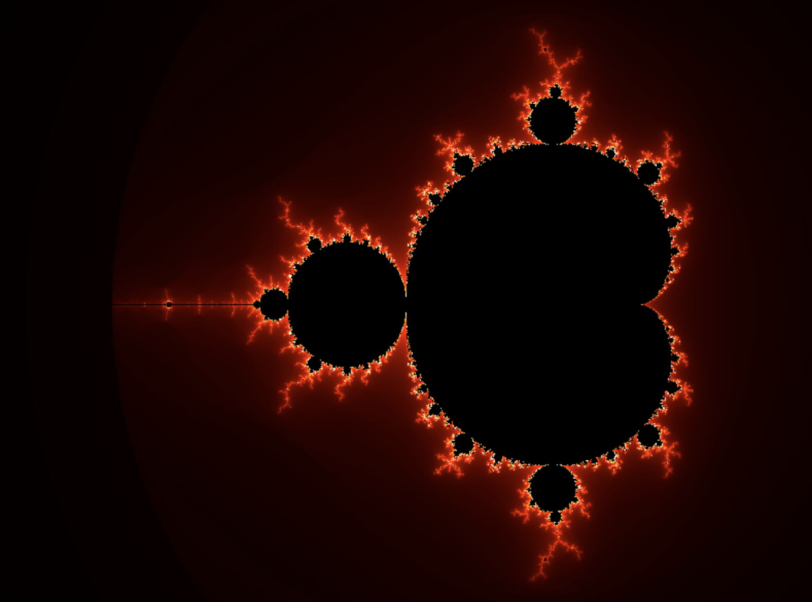

# Next Fractals - Interactive Mandelbrot Set Generator

A modern, interactive web application for exploring the infinite beauty of the Mandelbrot set, built with Next.js 14 and TypeScript.



**App (main branch) deployed on GCP Cloud Run:**
- **[🌐 https://fractals-nextjs-main-u7kvobazsa-uc.a.run.app/](https://fractals-nextjs-main-u7kvobazsa-uc.a.run.app/)**

**App is continuously deployed via CI/CD using this repo:**
- **[🌐 https://bitbucket.org/sloanahrens/nextjs-tf-gcp-demo](https://bitbucket.org/sloanahrens/nextjs-tf-gcp-demo)**

## Overview

Next Fractals is a real-time fractal generator that allows users to explore the Mandelbrot set with smooth zoom controls, customizable parameters, and preset configurations. The application uses optimized Canvas API rendering with progressive calculation techniques for smooth performance and provides an intuitive interface for mathematical visualization.

## Features

### 🎨 Interactive Visualization
- **Real-time Rendering**: Smooth fractal generation with optimized performance
- **Zoom Controls**: Seamless zooming with mouse wheel and touch gestures
- **Pan Navigation**: Click and drag to explore different regions
- **Center Controls**: Precise positioning with coordinate input

### ⚙️ Customizable Parameters
- **Iteration Control**: Adjust detail level with iteration sliders
- **Color Mapping**: Dynamic color schemes for enhanced visualization
- **Parameter Presets**: Quick access to interesting fractal configurations
- **Custom Presets**: Save and manage your own configurations

### 🚀 Technical Features
- **Canvas API Rendering**: Direct pixel manipulation for optimal performance
- **Progressive Rendering**: Non-blocking calculations with requestAnimationFrame
- **Responsive Design**: Works seamlessly across desktop and mobile devices
- **TypeScript**: Full type safety and enhanced developer experience

### 🔧 DevOps & CI/CD Features
- **Bitbucket Pipelines**: Automated testing and deployment on every commit
- **Containerized Deployment**: Docker-based deployment to GCP Cloud Run
- **Multi-stage Builds**: Optimized Docker images for production
- **ESLint Integration**: Code quality checks in CI/CD pipeline
- **TypeScript Validation**: Compile-time type checking in build process

## Technology Stack

- **Framework**: [Next.js 14](https://nextjs.org/) with App Router
- **Language**: [TypeScript](https://www.typescriptlang.org/)
- **Styling**: [Tailwind CSS](https://tailwindcss.com/)
- **Performance**: Optimized Canvas API rendering
- **UI Components**: Custom React components with modern design

## Getting Started

### Prerequisites

- Node.js 18.0 or later
- npm or yarn package manager

### Installation

1. Clone the repository:
```bash
git clone <repository-url>
cd fractals-nextjs
```

2. Install dependencies:
```bash
npm install
```

3. Run the development server:
```bash
npm run dev
```

4. Open [http://localhost:3000](http://localhost:3000) in your browser to start exploring!

## Docker Commands

For testing and deployment, you can use these Docker commands:

```bash
# Test CI/CD pipeline locally (runs build, lint, and type checking)
docker run --rm -v $(pwd):/app -w /app node:20-alpine sh -c "npm ci && npm run build && npm run lint && npx tsc --noEmit"

# Build production Docker image
docker build --platform linux/amd64 -t fractals-next:test -f Dockerfile .

# Run production container locally
docker run --rm -p 8080:8080 fractals-next:test
```

The production container will be available at [http://localhost:8080](http://localhost:8080).

## Usage

### Basic Navigation
- **Zoom In/Out**: Use mouse wheel or zoom controls
- **Pan**: Click and drag to move around the fractal
- **Reset**: Use preset configurations to jump to interesting locations

### Advanced Features
- **Custom Presets**: Create and save your own fractal configurations
- **Parameter Adjustment**: Fine-tune iterations and other settings
- **Export**: Save your discoveries as images or configuration files

## Project Structure

```
src/
├── app/                    # Next.js App Router pages
│   ├── layout.tsx         # Root layout with meta tags
│   ├── page.tsx           # Main fractal viewer page
│   └── globals.css        # Global styles
├── components/
│   └── ui/                # Reusable UI components
├── lib/                   # Core logic and utilities
│   ├── mandelbrot.ts      # Mandelbrot set calculations
│   ├── fractalRenderer.ts # Rendering engine
│   ├── colorMapping.ts    # Color scheme utilities
│   ├── presets.ts         # Preset configurations
│   └── zoomPan.ts         # Interactive controls
├── types/                 # TypeScript type definitions
└── public/                # Static assets
```

## Mathematics Behind the Magic

The Mandelbrot set is defined by the iterative formula:

```
z₀ = 0
z_{n+1} = z_n² + c
```

Where `c` is a complex number representing each pixel's coordinate. Points that don't diverge to infinity after a maximum number of iterations are considered part of the set.

## Performance Optimization

- **Canvas API Rendering**: Direct pixel manipulation for optimal performance
- **Progressive Rendering**: Non-blocking calculations with requestAnimationFrame
- **Cancellable Operations**: Rendering can abort when parameters change mid-calculation
- **Memory Management**: Efficient canvas and data structure handling

## Contributing

Contributions are welcome! Please feel free to submit a Pull Request. For major changes, please open an issue first to discuss what you would like to change.

## License

This project is licensed under the MIT License - see the [LICENSE](LICENSE) file for details.

## Acknowledgments

- Inspired by the mathematical beauty of Benoit Mandelbrot's work
- Built with modern web technologies for optimal performance
- Designed for both mathematical exploration and visual enjoyment

## Deployment

### 🚀 Bitbucket Pipelines

The project uses Bitbucket Pipelines for automated CI/CD. Every commit triggers:

1. **Build and Test**: Runs `npm ci`, `npm run build`, `npm run lint`, and TypeScript compilation
2. **Deploy to Cloud Run**: Automatically deploys to GCP Cloud Run (requires environment variables)

### 📚 Documentation

**Development:**
- **[Developer Guide](CLAUDE.md)** - Architecture overview and development setup

### Alternative Deployments

- **Vercel**: Deploy directly from GitHub with zero configuration
- **Netlify**: Static export with `npm run build`
- **Docker**: Use the included `Dockerfile` for any container platform

---

**Explore the infinite complexity of mathematics through interactive visualization.**

🚀 **Deploy to GCP**: See [deployment section](#-bitbucket-pipelines) above
